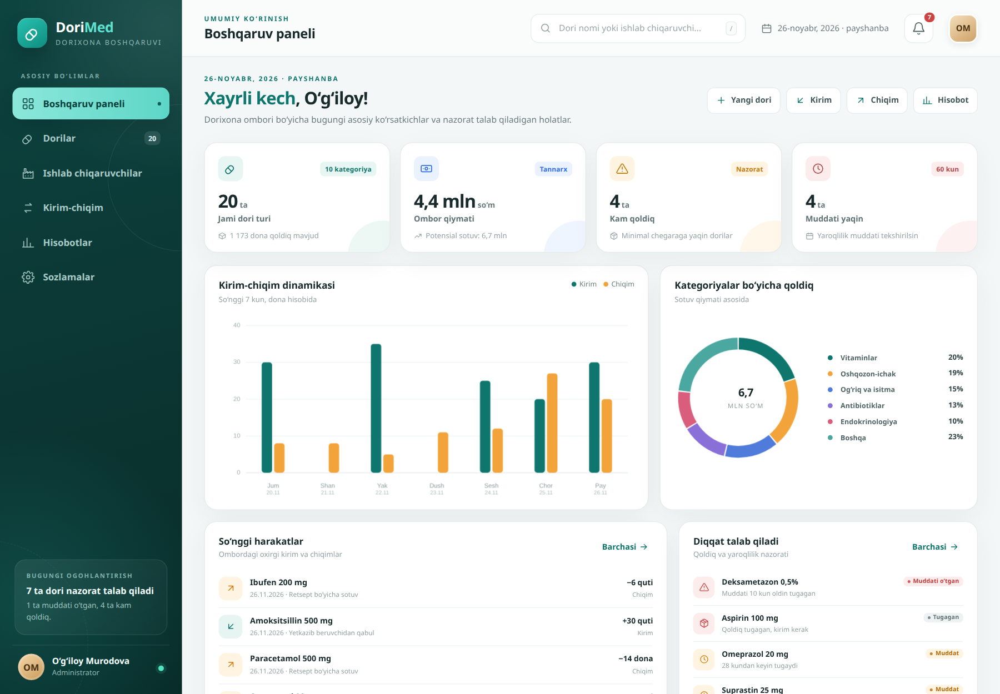

# DoriMed — dorixona boshqaruv tizimi

**DoriMed** — dorilar, ishlab chiqaruvchilar, yaroqlilik muddati, narxlar, kirim-chiqim va ombor qoldig'ini yagona joyda boshqarish uchun yaratilgan bitta sahifali web ilova. Ilova bitta `index.html` faylidan iborat, server va ma'lumotlar bazasi talab qilmaydi; barcha yozuvlar brauzerning `localStorage` xotirasida saqlanadi.

**Demo:** [ogiloymuradova1679-rgb.github.io/dorixona-boshqaruv-tizimi](https://ogiloymuradova1679-rgb.github.io/dorixona-boshqaruv-tizimi/)

[](https://github.com/ogiloymuradova1679-rgb/dorixona-boshqaruv-tizimi/actions/workflows/ci.yml)



## Asosiy imkoniyatlar

- dorilar kartochkalari: nomi, kategoriyasi, ishlab chiqaruvchisi, partiyasi, yaroqlilik muddati, tannarx va sotuv narxi, qoldiq, minimal qoldiq, javon;
- ishlab chiqaruvchilar bazasi va ularga bog'langan dori vositalari;
- kirim-chiqim operatsiyalari: qoldiqning avtomatik yangilanishi, qoldiq yetarliligini tekshirish, muddati o'tgan dorini chiqim qilishni bloklash;
- boshqaruv panelida asosiy ko'rsatkichlar, 7 kunlik dinamika va kategoriyalar diagrammasi;
- kam qoldiq, tugagan va yaroqlilik muddati yaqin dorilar bo'yicha ogohlantirishlar;
- qidiruv, kategoriya va holat bo'yicha filtrlash;
- ombor hisoboti, CSV eksport, chop etish;
- JSON zaxira nusxasini olish va tiklash, demo ma'lumotlarini qayta yuklash;
- mobil va planshet ekranlariga moslashgan interfeys;
- tashqi kutubxonalarsiz ishlash (offline rejimda ham ochiladi).

## Texnologiyalar

| Qatlam | Texnologiya |
|---|---|
| Belgilash | HTML5 |
| Ko'rinish | CSS3, Flexbox, CSS Grid, media queries |
| Mantiq | Vanilla JavaScript (ES6+) |
| Diagrammalar | Canvas 2D API |
| Saqlash | Web Storage API (`localStorage`) |
| Chop etish | `window.print()` va `@media print` |
| Joylashtirish | GitHub Pages |
| Sifat nazorati | GitHub Actions, Python tekshiruv skripti |

Ilova ishlashi uchun internet, CDN yoki npm paketlari kerak emas.

## Sifat nazorati

Har bir push va Pull Request’da GitHub Actions ishga tushadi. Workflow `scripts/check_app.py` orqali HTML tuzilmasi, unikal ID’lar, tashqi bog‘liqliklar va xavfsizlik belgilarini tekshiradi, so‘ng inline JavaScript’ni `node --check` bilan sintaksis tekshiruvidan o‘tkazadi. Batafsil: [`.github/workflows/ci.yml`](.github/workflows/ci.yml).

## Mahalliy ishga tushirish

1. Repozitoriyani klonlang:

   ```bash
   git clone https://github.com/ogiloymuradova1679-rgb/dorixona-boshqaruv-tizimi.git
   cd dorixona-boshqaruv-tizimi
   ```

2. `index.html` faylini brauzerda oching yoki kichik lokal server ishga tushiring:

   ```bash
   python3 -m http.server 8000
   ```

3. Brauzerda `http://localhost:8000` manzilini oching.

Demo ma'lumotlari birinchi ochilishda avtomatik yuklanadi. **Sozlamalar → Demo ma'lumotlari** tugmasi orqali boshlang'ich holatni qaytarish mumkin.

## Ma'lumotlar modeli

Ilova uchta asosiy massivdan foydalanadi:

| Obyekt | Asosiy maydonlar |
|---|---|
| `medicines` | `id`, `name`, `category`, `manufacturerId`, `batch`, `expiry`, `purchasePrice`, `price`, `stock`, `minStock`, `unit`, `shelf` |
| `manufacturers` | `id`, `name`, `country`, `phone`, `email`, `note` |
| `transactions` | `id`, `type` (`in`/`out`), `medicineId`, `medicineName`, `qty`, `unitPrice`, `total`, `date`, `note` |

`transactions` yozuvlari audit tarixi sifatida saqlanadi. Chiqim amalga oshirilganda dori qoldig'i kamayadi, kirimda esa ortadi. Muddati o'tgan dori uchun chiqim operatsiyasi bloklanadi.

## Loyiha tuzilmasi

```text
dorixona-boshqaruv-tizimi/
├── index.html                         # butun ilova (HTML + CSS + JS)
├── README.md
├── .github/
│   ├── workflows/ci.yml               # GitHub Actions CI
│   ├── ISSUE_TEMPLATE/user-story.md   # user story shabloni
│   └── PULL_REQUEST_TEMPLATE.md
├── docs/
│   ├── TEXNIK_TOPSHIRIQ.md            # texnik topshiriq
│   ├── ARXITEKTURA.md                 # arxitektura va ma'lumotlar modeli
│   ├── LOYIHA_XARTIYASI.md            # qisqa loyiha xartiyasi
│   ├── assets/                        # ekran tasvirlari va diagrammalar
│   └── lablar/                        # 7 ta laboratoriya ishi (DOCX)
└── scripts/
    └── check_app.py                   # CI sifat tekshiruvi
```

## Hujjatlar

- [Texnik topshiriq](docs/TEXNIK_TOPSHIRIQ.md)
- [Arxitektura](docs/ARXITEKTURA.md)
- [Loyiha xartiyasi](docs/LOYIHA_XARTIYASI.md)
- [Jira backlog — CSV](docs/jira-backlog.csv)

### Laboratoriya ishlari (DOCX)

| № | Mavzu | Hujjat |
|---|---|---|
| L1 | Loyiha xartiyasi va GitHub repo | [L1_Loyiha_xartiyasi_va_GitHub.docx](docs/lablar/L1_Loyiha_xartiyasi_va_GitHub.docx) |
| L2 | User story va Planning Poker | [L2_User_story_va_Planning_Poker.docx](docs/lablar/L2_User_story_va_Planning_Poker.docx) |
| L3 | Jira sprint va Git Pull Request | [L3_Jira_sprint_va_Git.docx](docs/lablar/L3_Jira_sprint_va_Git.docx) |
| L4 | Gantt diagrammasi va risk registri | [L4_Gantt_va_Risk_registr.docx](docs/lablar/L4_Gantt_va_Risk_registr.docx) |
| L5 | Code review va CI pipeline | [L5_Code_review_va_CI.docx](docs/lablar/L5_Code_review_va_CI.docx) |
| L6 | Sprint retrospektivasi va burndown | [L6_Retrospektiva_va_Burndown.docx](docs/lablar/L6_Retrospektiva_va_Burndown.docx) |
| L7 | COCOMO, MLOps va yakuniy himoya | [L7_COCOMO_va_MLOps.docx](docs/lablar/L7_COCOMO_va_MLOps.docx) |

## Loyiha boshqaruvi

- GitHub Issues — user story va vazifalar;
- label va milestone — prioritet va sprintlar;
- Pull Request — kod ko'rib chiqish va CI tekshiruvi;
- GitHub Actions — har bir push va PR'da avtomatik sifat nazorati;
- GitHub Pages — demo muhiti.

## Reliz

- **v1.0.0** — birinchi yakuniy demo, 2026-yil noyabr: [releases/tag/v1.0.0](https://github.com/ogiloymuradova1679-rgb/dorixona-boshqaruv-tizimi/releases/tag/v1.0.0)

## Muallif

**Murodova O'g'iloy Qahramon qizi**  
Urganch davlat universiteti, Kompyuter injiniring fakulteti  
KIDT yo'nalishi, masofaviy 236-guruh  
Fan: Loyihalarni boshqarish  
Qabul qiluvchi: Xusainov Shixnazar

Email: [ogiloymuradova1679@gmail.com](mailto:ogiloymuradova1679@gmail.com)

## Litsenziya

Loyiha o'quv maqsadida yaratilgan. Batafsil: [LICENSE](LICENSE).
